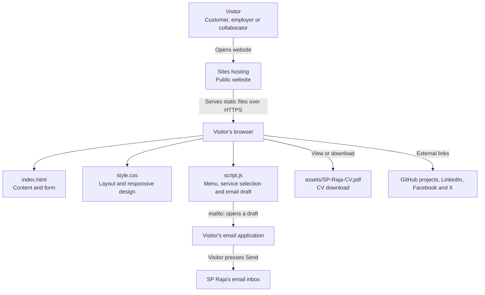
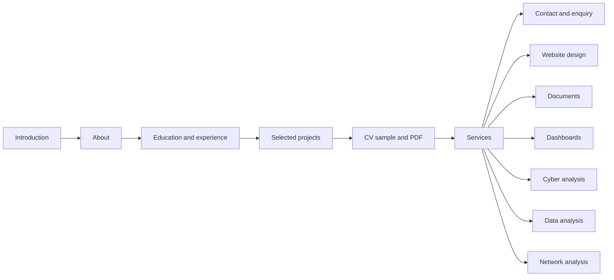
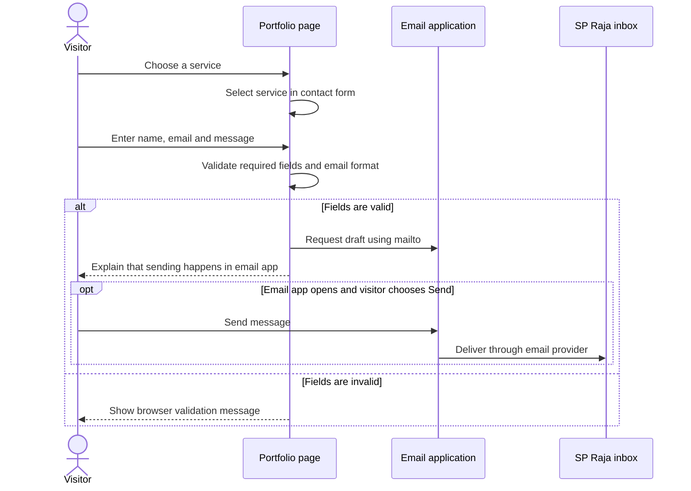
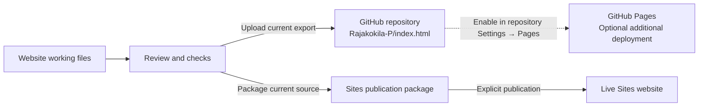
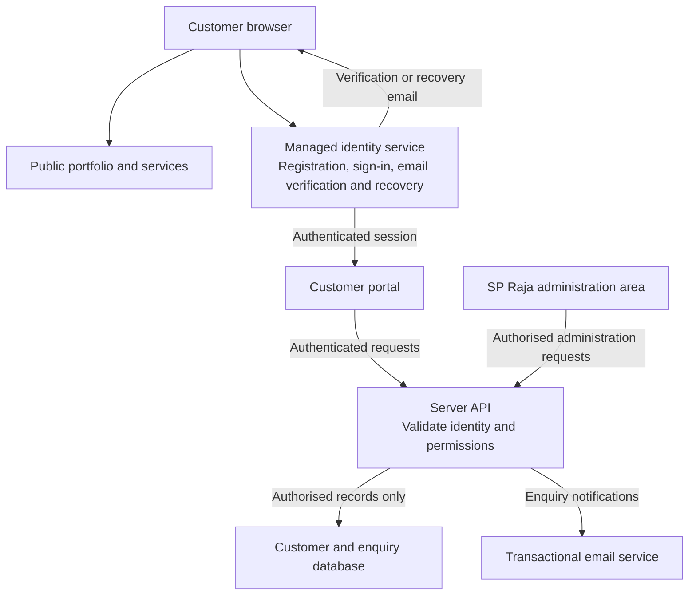

# SP Raja Portfolio Architecture

This document describes the portfolio's implemented architecture and a proposed extension for customer accounts. The current website is a static application: the visitor's browser displays the content and runs its interactions.

## Current system

There is no application server, customer database, or account system in the current project. Form details are used in the browser to prepare an email draft; the site does not save them. Email delivery depends on the visitor's configured email application and their decision to send.

## Information architecture

The website is one HTML page with section links, rather than separate pages.

Selecting a service takes the visitor to the contact section and selects that service in the enquiry form.

## Components and responsibilities

| Component | Responsibility |
| --- | --- |
| `index.html` | Profile, education, experience, projects, CV sample, services, social links, and labelled form fields |
| `style.css` | Colours, typography, grid layouts, mobile breakpoints, focus indicators, and reduced-motion support |
| `script.js` | Mobile menu state, Escape handling, service selection, form validation, email draft creation, and footer year |
| `assets/SP-Raja-CV.pdf` | Two-page CV available for viewing and downloading |
| `.nojekyll` | Allows the exported project to be served as plain static files on GitHub Pages |
| `README.md` | Overview, design rationale, features, verification status, and deployment instructions |

The contact form uses browser validation for required fields and email format. Its success message explains that an email draft was requested; it does not claim the enquiry was delivered.

## Enquiry flow

## Source and deployment

- **Live site:** https://rajak-personal-portfolio.wise-wasp-0659.chatgpt.site/
- **GitHub repository:** https://github.com/Rajakokila-P/index.html
- The Sites project serves its configured `dist` directory.
- The GitHub export places the same public website files at the repository root.
- GitHub and Sites are separate publication destinations. Updating GitHub does not currently update the Sites website automatically.
- GitHub Pages is an optional hosting destination; its activation has not been verified.

## Public information and access

Visitors can browse the public website without signing in. The downloadable CV and website omit the street address. The owner-approved phone number, email address, and social links remain public.

The GitHub export contains current website files and the corrected CV. Original CV documents, recordings, the course handbook, hosting credentials, and previous Sites source history are not part of that export.

## Proposed customer account architecture

**Future design only — these components have not been implemented.** A supported authentication and hosting arrangement must be selected before adding email/password registration and recovery.

The future server would verify the identity and ownership of every customer record before returning or changing it. The identity provider would manage passwords and recovery; browser code would not store passwords or service secrets. The administration area would require an owner role checked by the server.

A future enquiry form would submit to the server and show confirmation only after the enquiry is saved or accepted. This differs from the current email-draft workflow and requires backend implementation and testing.

## Verification status

The current JavaScript syntax, section links, service count, contact targets, and CV availability were checked. Both PDF pages were visually inspected, and Sites confirmed successful publication. Full browser interaction, responsive-layout, and automated accessibility testing remain outstanding.
