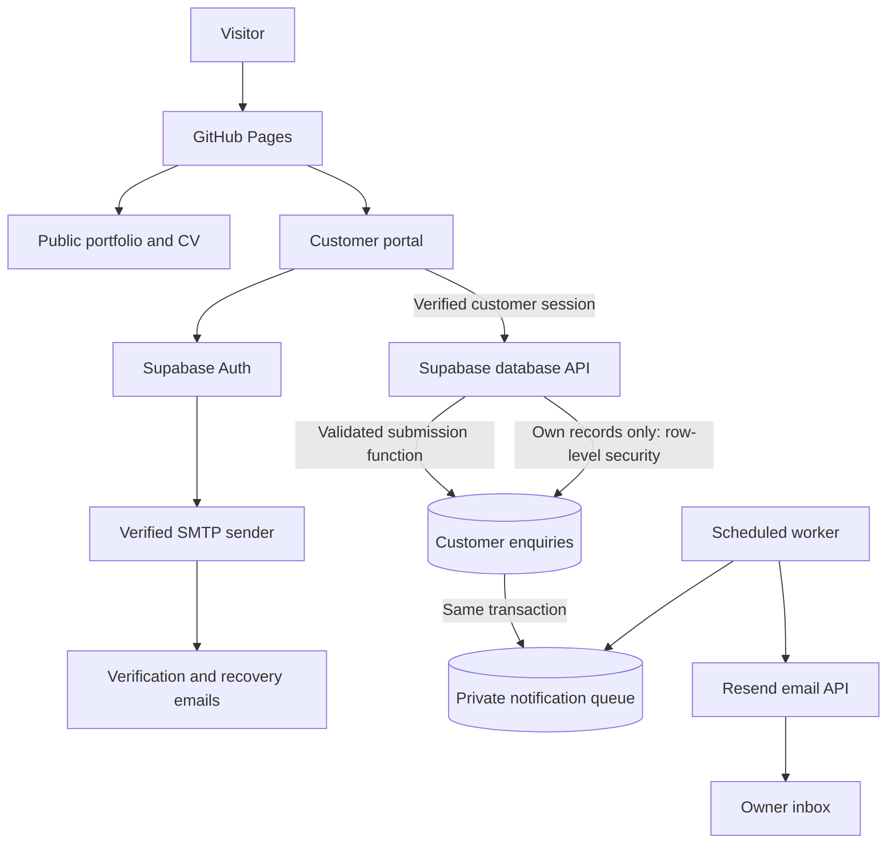
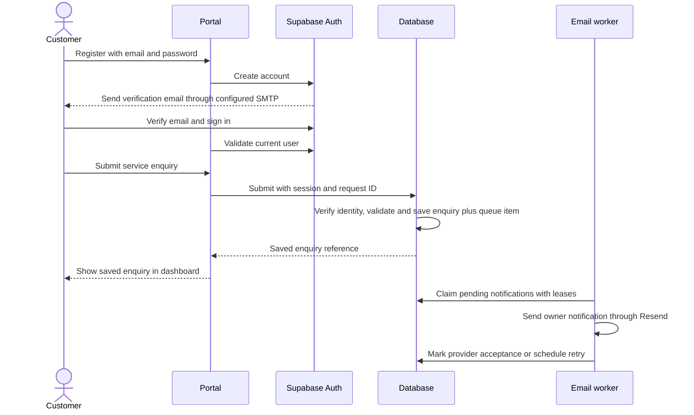
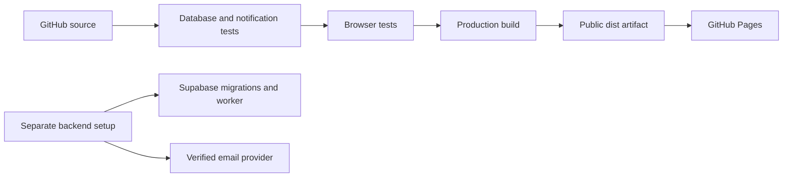

# SP Raja Portfolio Architecture

The GitHub version contains a public portfolio and a customer portal backed by Supabase, with enquiry notifications through Resend. Source and local tests are complete; hosted authentication and email are **not activated**. See [activation instructions](BACKEND-SETUP.md).

## Application architecture

The public portfolio remains available without an account. It contains education, experience, projects, a corrected CV sample, six services, and approved contact/social links. The street address is excluded. The original public enquiry form opens an email draft; customers can use the separate portal for saved, tracked enquiries once activated.

## Components

| Component | Responsibility |
| --- | --- |
| index.html, style.css, script.js | Public portfolio, responsive navigation, services and email-draft fallback |
| portal.html, portal.css, src/portal.js | Registration, sign-in, verification resend, recovery, protected dashboard and enquiries |
| Supabase Auth | Password handling, verified email identity and sessions |
| Database migration | Enquiry validation, ownership rules, idempotency, submission limits and notification queue |
| notify-enquiries function | Authenticated server worker, email dispatch and retry handling |
| Scheduled database job | Calls the notification worker every five minutes |
| config.json | Public backend URL and publishable key; empty until activation |
| Build scripts | Bundle the browser SDK and copy only public files into dist |
| GitHub Actions workflow | Tests, browser checks, build and Pages deployment |

## Customer and enquiry flow

Saving an enquiry and queue entry is atomic. Repeating a request with the same ID and content does not create duplicates. Email failure does not remove the saved enquiry. Provider acceptance is recorded separately from customer submission; it does not prove inbox delivery. After eight unsuccessful attempts, the owner must investigate and requeue deliberately.

## Access and privacy

- Database row-level security restricts customers to their own enquiries. Browser visibility is not the security boundary.
- Customers cannot write directly to tables, change enquiry status, or read the notification queue. The submission function verifies the confirmed account email, validates data, and limits each customer to five enquiries per hour.
- Only the server worker has access to notification processing functions. It checks a separate server secret before accessing the queue.
- Browser configuration contains only public connection settings. Service credentials and email keys belong in server secret storage.
- Customer sessions use tab-scoped session storage. Sign-out clears displayed records. Untrusted enquiry text is rendered as text, not HTML.
- The owner manages records through the authenticated Supabase dashboard. A custom owner administration interface is not included.
- Without backend configuration, the portal displays contact alternatives and does not collect passwords.

## Deployment

Set GitHub Pages source to **GitHub Actions** once. Thereafter, pushes to main use the workflow; failed checks block deployment. Backend migrations, SMTP configuration and worker deployment are separate setup steps described in BACKEND-SETUP.md.

The existing [Sites-hosted portfolio](https://rajak-personal-portfolio.wise-wasp-0659.chatgpt.site/) is a separate publication. This workflow updates the GitHub Pages version and does not synchronise the Sites copy.

## Verification and remaining activation

Local verification passed 33 browser checks and 11 database/notification tests. Browser auth and provider responses are simulated; database permissions are exercised against the actual migration in embedded PostgreSQL. See [testing details](TESTING.md).

Live signup, SMTP delivery, recovery links, hosted row-level security and notification delivery must still be tested after connecting Supabase and Resend and configuring a verified sending domain. No production accounts or emails were created during local testing.

